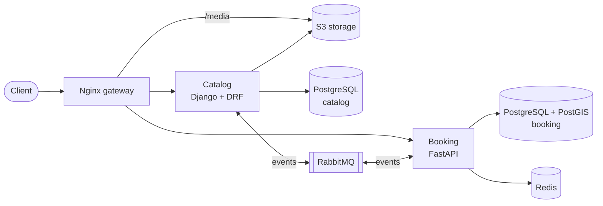
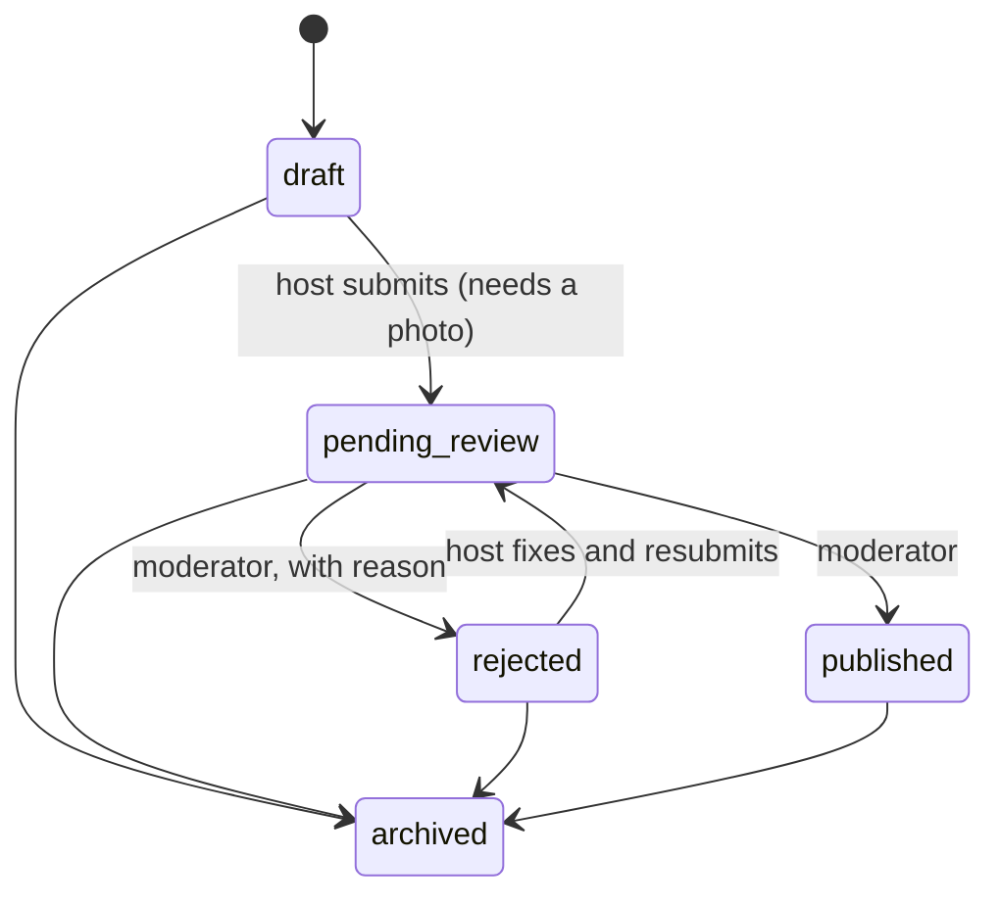

# Booking Platform

Backend for a short-term rental marketplace: hosts publish apartments and houses,
guests search by map and dates and book with prepayment. The core engineering goal is
that the same dates can never be sold twice, even under heavy concurrent load.

> Work in progress. Stage 1 (Catalog service) is done; see the [roadmap](#roadmap).

## Architecture



| Service | Owns | Why this framework |
|---|---|---|
| **Catalog** | users and JWT issuing, listings, photos, moderation, reviews, notifications | Django Admin, auth, ORM and migrations out of the box: ideal for CRUD and a back-office |
| **Booking** *(stage 2+)* | search, calendar, pricing, bookings, payments | async I/O and strict typing for the high-traffic path |

Each service owns its database and services never call each other synchronously while
serving a request. Design decisions are recorded in [`docs/adr`](docs/adr).

## Tech stack

Python 3.13 · Django 5.2 · DRF · FastAPI · PostgreSQL 17 + PostGIS · Redis · RabbitMQ ·
Celery · S3-compatible storage (RustFS locally) · Nginx · Docker Compose · uv · ruff ·
mypy · pytest + Testcontainers · GitHub Actions

## Quick start

Requirements: Docker with Compose v2 and Python 3 (only to generate secrets).

```bash
python scripts/init_env.py      # creates .env with random secrets
docker compose up -d --build
docker compose exec catalog-api python manage.py createsuperuser
```

| URL | What |
|---|---|
| http://localhost/api/docs/catalog/ | Catalog API (Swagger UI) |
| http://localhost/admin/ | Moderation desk (Django Admin) |
| http://localhost/.well-known/jwks.json | Public keys for JWT verification |
| http://localhost:15672 | RabbitMQ management |
| http://localhost:9001 | Object storage console |

## Catalog API

| Method | Path | Who | Description |
|---|---|---|---|
| POST | `/api/v1/auth/register` | anyone | Create an account |
| POST | `/api/v1/auth/token` | anyone | Log in, get access and refresh tokens |
| POST | `/api/v1/auth/token/refresh` | anyone | Rotate the refresh token |
| POST | `/api/v1/auth/logout` | anyone | Revoke a refresh token |
| GET, PATCH | `/api/v1/users/me` | user | Profile |
| POST | `/api/v1/users/me/host` | user | Become a host (returns tokens with the new role) |
| GET | `/api/v1/amenities` | anyone | Amenity dictionary |
| GET | `/api/v1/listings/{id}` | anyone | Published listing |
| GET, POST | `/api/v1/host/listings` | host | Own listings |
| GET, PATCH, DELETE | `/api/v1/host/listings/{id}` | host | Manage a listing |
| POST | `/api/v1/host/listings/{id}/submit` | host | Send for moderation |
| POST | `/api/v1/host/listings/{id}/archive` | host | Withdraw a listing |
| POST | `/api/v1/host/listings/{id}/photos` | host | Get a presigned upload |
| POST | `/api/v1/host/listings/{id}/photos/{photo_id}/complete` | host | Confirm the upload |
| DELETE | `/api/v1/host/listings/{id}/photos/{photo_id}` | host | Remove a photo |

Errors follow [RFC 9457](https://www.rfc-editor.org/rfc/rfc9457) (`application/problem+json`).

### Listing lifecycle



### Photo upload

1. `POST .../photos` returns a presigned POST pinned to the key, content type and 10 MB.
2. The client uploads the file straight to object storage; API workers never see the bytes.
3. `POST .../complete` queues a Celery task that validates the image, renders WebP
   variants without EXIF (no GPS leaks) and deletes the private original.

## Development

```bash
cd services/catalog
uv sync
uv run pytest          # spins up PostgreSQL via Testcontainers (Docker required)
uv run mypy .
uvx ruff@0.17.3 check . && uvx ruff@0.17.3 format --check .
```

Install the git hooks once with `uvx pre-commit install`.

## Roadmap

- [x] **Stage 1. Foundation and Catalog:** monorepo, Docker Compose, CI, users, JWT
  (RS256 + JWKS), listings, moderation, direct photo uploads.
- [ ] **Stage 2. Service integration:** transactional outbox → RabbitMQ → Booking read
  model; calendar, pricing and quotes.
- [ ] **Stage 3. Bookings:** exclusion constraint against double booking, idempotency,
  booking state machine, payment provider mock with webhooks, refunds, emails.
- [ ] **Stage 4. Search and reviews:** geo search with filters, caching, keyset
  pagination, rate limiting, reviews feeding the rating.
- [ ] **Stage 5. Load and operations:** Locust results, metrics and dashboards,
  image publishing.
