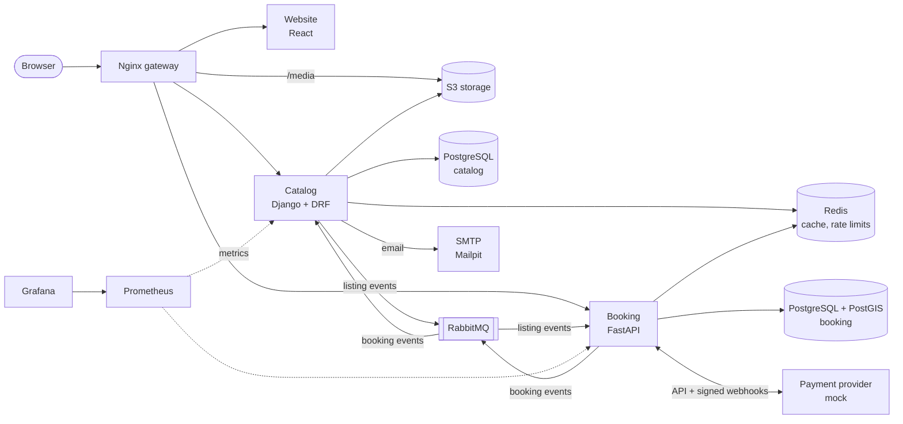
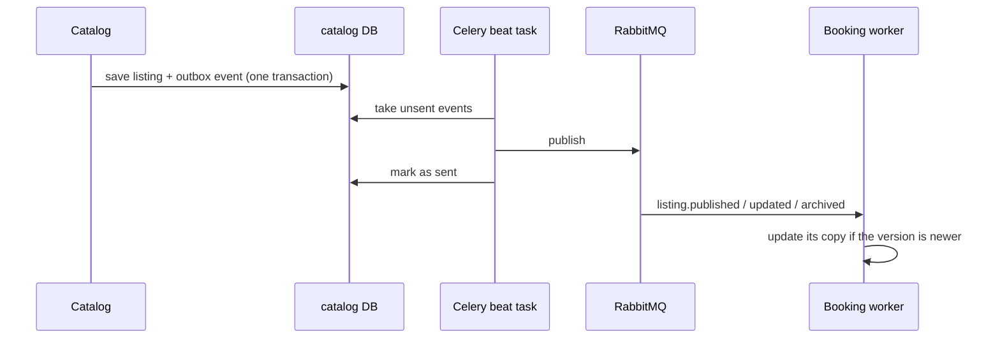
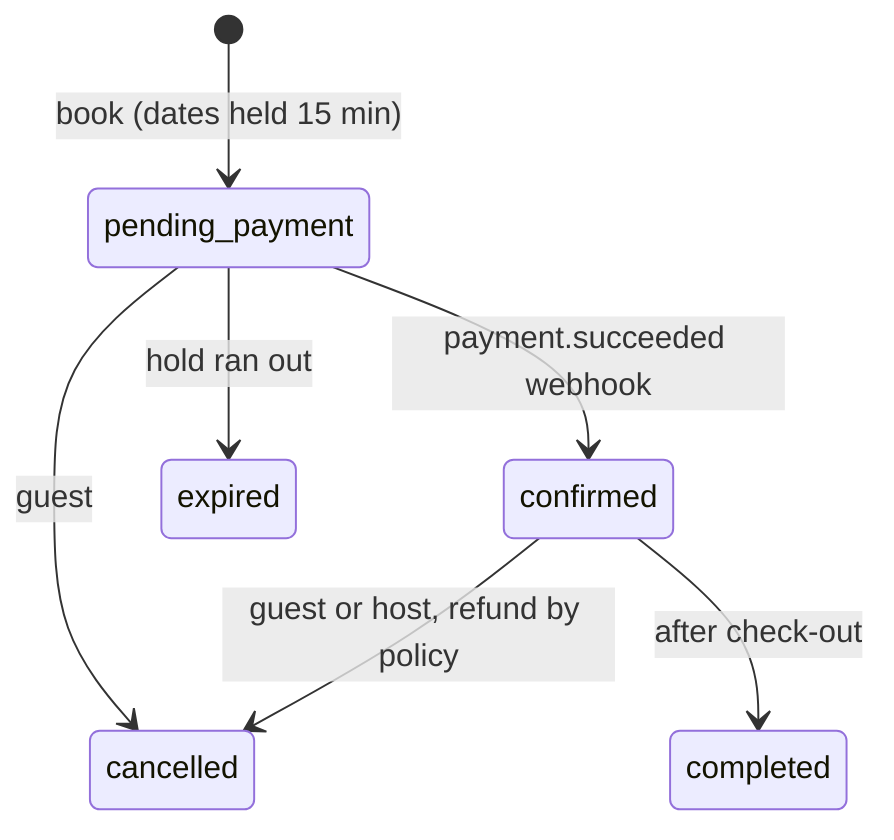
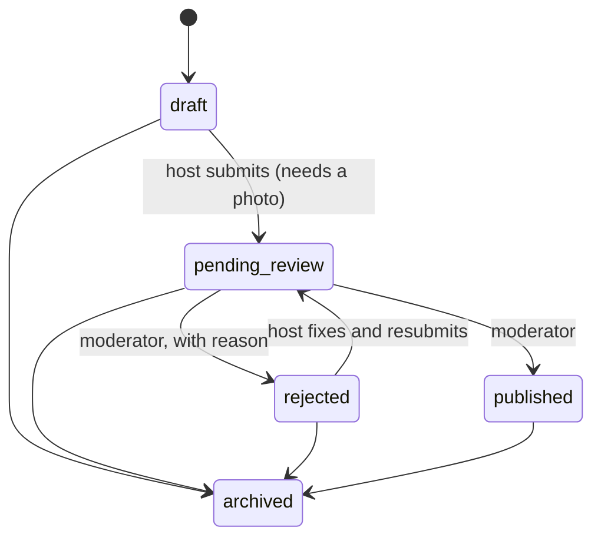

# Booking Platform

Backend for a short-term rental marketplace (like Booking.com or Airbnb): hosts publish
apartments and houses, guests search on the map, book dates and pay. The main rule: the
same night can never be sold twice, even when many guests book at the same moment.

Two services (Django and FastAPI) talk through RabbitMQ, a small React site shows the API
at work, and everything runs with one `docker compose up`. Design notes: [docs/architecture.md](docs/architecture.md); load test
results: [docs/load-testing.md](docs/load-testing.md).

## Features

- Accounts with JWT; hosts and guests.
- Listings with photos uploaded straight to S3 storage, moderation in Django Admin.
- Prices per night, weekends, seasons, discounts; calendar and price quotes.
- Search by map area or distance, dates, guests, amenities, price and rating.
- Bookings with a 15-minute hold, payments through a Stripe-like mock with signed
  webhooks, cancellations with refunds by policy.
- Emails on booking events, reviews after the stay, ratings in search.
- Help desk: users write to support from the website, staff answer in Django Admin and
  the answer also arrives by email.
- Messages between guest and host about a booking; saved listings; a profile with
  password change and "become a host".
- Redis cache and rate limits, Prometheus metrics and a Grafana dashboard, Locust load
  test, CI that tests the services and publishes Docker images.
- A small website (React + TypeScript): search with filters and a map view, a photo
  gallery, a date calendar with prices, booking and payment, messages, saved places,
  reviews, profile, and for hosts: adding places with photos, prices and closed dates.

## Project structure

```
backend/                 the main part: Python services
  catalog/               Django + DRF: users, listings, photos, reviews, emails
  booking/               FastAPI: search, prices, calendar, bookings, payments
  payment-mock/          FastAPI: a fake Stripe-like payment provider for local runs
  contracts/             event schemas shared by catalog and booking
frontend/                React + TypeScript showcase website
infra/                   configs: Nginx gateway, PostgreSQL init, Prometheus, Grafana
loadtest/                Locust scenario and demo data seeding
docs/                    architecture notes and load test results
scripts/init_env.py      creates .env with random secrets
docker-compose.yml       the whole stack in one command
```

See [backend/README.md](backend/README.md) for what is inside each service.

## Architecture



| Service | Owns | Why this framework |
|---|---|---|
| **Catalog** | users and JWT issuing, listings, photos, moderation, reviews, support, notifications | Django Admin, auth, ORM and migrations out of the box: ideal for CRUD and a back-office |
| **Booking** | search, availability, pricing, quotes, bookings, payments and refunds | async I/O and strict typing for the high-traffic path |

Each service has its own database. They don't call each other over HTTP: Booking checks
Catalog's JWTs with Catalog's public key and keeps its own copy of the listings, updated
by events.

### Event flow



Booking sends `booking.confirmed`, `booking.cancelled` and `booking.completed` the same
way; Catalog turns them into emails and opens a review after the stay. Event schemas are
shared Pydantic models in [`backend/contracts`](backend/contracts).

## Tech stack

Python 3.13 · Django 5.2 · DRF · FastAPI · SQLAlchemy 2 (async) · Alembic · FastStream ·
PostgreSQL 17 + PostGIS · Redis · RabbitMQ · Celery · S3-compatible storage (RustFS
locally) · Mailpit · Nginx · Prometheus · Grafana · Locust · Docker Compose · uv · ruff ·
mypy · pytest + Testcontainers · GitHub Actions

Website: React 19 · TypeScript · Vite · React Router · TanStack Query · Leaflet

## Quick start

Requirements: Docker with Compose v2 and Python 3 (only to generate secrets).

```bash
python scripts/init_env.py      # creates .env with random secrets (adds new keys on upgrade)
docker compose up -d --build
docker compose exec catalog-api python manage.py createsuperuser
```

To fill the site with demo listings (300 places in 8 cities, each with 3-5 photos):
`python loadtest/seed.py`. Listings seeded before photos existed get them with
`docker compose exec catalog-api python manage.py seed_photos`. The demo photos are free
Unsplash images, see [`backend/catalog/demo/photos/CREDITS.md`](backend/catalog/demo/photos/CREDITS.md).

| URL | What |
|---|---|
| http://localhost/ | The website |
| http://localhost/api/docs/catalog/ | Catalog API (Swagger UI) |
| http://localhost/api/docs/booking/ | Booking API (Swagger UI) |
| http://localhost/admin/ | Moderation desk (Django Admin) |
| http://localhost/.well-known/jwks.json | Public keys for JWT verification |
| http://localhost:8025 | Mailpit: every email the platform sends |
| http://localhost:8090/docs | Payment provider mock |
| http://localhost:3000 | Grafana: the "Booking Platform" dashboard (admin / `GRAFANA_ADMIN_PASSWORD` from `.env`) |
| http://localhost:9090 | Prometheus |
| http://localhost:15672 | RabbitMQ management |
| http://localhost:9001 | Object storage console |

## Website

A deliberately small showcase of the API in [`frontend/`](frontend); the backend is the
main part of this project.

- **Search**: place, dates (a calendar), guests and "Filters": price per night, type of
  place, bedrooms, rating, amenities. Results come as a grid of places; "Show map"
  switches to a map with price tags, where "Search this area" searches what the map
  shows. Filters live in the URL, so a search can be shared.
- **Listing**: a photo gallery (arrows, thumbnails, keyboard), amenities, reviews and a
  calendar for the next six months: taken
  nights are greyed out and every free night shows its price. The heart saves the place
  to "Saved".
- **Booking**: log in or register and book. The booking's page shows the price, the
  dates and how long they are held; "Pay" opens the provider's checkout, where the test
  card `4242 4242 4242 4242` pays and `4000 0000 0000 0002` is declined. After paying,
  the guest comes back to the booking and sees it confirmed. Cancel to see the refund.
  The same page has messages with the host, and after the stay a form to rate it.
- **Hosting** (for hosts): their places and the bookings of them, each booking with the
  conversation with the guest and a cancel button.
- **Add a place** (for hosts): details, amenities and a point on the map; then photos
  (uploaded straight to object storage), "Send for review", and once a moderator has
  published it in Django Admin, prices and closed dates. Drafts can be deleted,
  published places archived.
- **Profile**: name, password, "Become a host".

- **Help**: write to support about a booking, a payment or the account, and follow the
  conversation. Staff answer in Django Admin (Support requests); the user also gets the
  answer by email.

Moderators publish or reject listings in Django Admin (Listings).

## API

All services sit behind one gateway, so clients see a single API. Paths are routed to the
owning service by Nginx.

### Catalog

| Method | Path | Who | Description |
|---|---|---|---|
| POST | `/api/v1/auth/register` | anyone | Create an account |
| POST | `/api/v1/auth/token` | anyone | Log in, get access and refresh tokens |
| POST | `/api/v1/auth/token/refresh` | anyone | Rotate the refresh token |
| POST | `/api/v1/auth/logout` | anyone | Revoke a refresh token |
| GET, PATCH | `/api/v1/users/me` | user | Profile |
| POST | `/api/v1/users/me/host` | user | Become a host (returns tokens with the new role) |
| POST | `/api/v1/users/me/password` | user | Change the password (needs the current one) |
| GET | `/api/v1/favorites` | user | Saved listings |
| PUT, DELETE | `/api/v1/favorites/{listing_id}` | user | Save or unsave a listing |
| GET | `/api/v1/amenities` | anyone | Amenity dictionary |
| GET | `/api/v1/listings/{id}` | anyone | Published listing with its rating (cached) |
| GET | `/api/v1/listings/{id}/reviews` | anyone | Reviews, newest first (`page`, `page_size`) |
| GET | `/api/v1/reviews/pending` | user | Own finished stays that can still be reviewed |
| POST | `/api/v1/reviews` | user | Review a finished stay: 1 to 5 and a text, once, within 14 days |
| POST | `/api/v1/host/reviews/{id}/reply` | host | Reply publicly to a review, once |
| GET, POST | `/api/v1/support/tickets` | user | Own support requests; open a new one |
| GET | `/api/v1/support/tickets/{id}` | user | A request with its messages |
| POST | `/api/v1/support/tickets/{id}/messages` | user | Write to support again |
| POST | `/api/v1/support/tickets/{id}/close` | user | Close a solved request |
| GET, POST | `/api/v1/host/listings` | host | Own listings |
| GET, PATCH, DELETE | `/api/v1/host/listings/{id}` | host | Manage a listing |
| POST | `/api/v1/host/listings/{id}/submit` | host | Send for moderation |
| POST | `/api/v1/host/listings/{id}/archive` | host | Withdraw a listing |
| POST | `/api/v1/host/listings/{id}/photos` | host | Get a presigned upload |
| POST | `/api/v1/host/listings/{id}/photos/{photo_id}/complete` | host | Confirm the upload |
| DELETE | `/api/v1/host/listings/{id}/photos/{photo_id}` | host | Remove a photo |

### Booking

Amounts are integers in minor units (cents). Periods are `[start_date, end_date)`.

| Method | Path | Who | Description |
|---|---|---|---|
| GET | `/api/v1/listings` | anyone | Search: map area or point, dates, filters, sorting |
| GET | `/api/v1/listings/{id}/calendar` | anyone | Nightly availability and prices |
| GET | `/api/v1/listings/{id}/quote` | anyone | Price breakdown for `check_in`, `check_out`, `guests` |
| GET, PUT | `/api/v1/host/listings/{id}/pricing` | host | Nightly, weekend price, cleaning fee, stay limits, discounts |
| GET, POST | `/api/v1/host/listings/{id}/seasonal-rates` | host | Prices for a period (no overlaps) |
| DELETE | `/api/v1/host/listings/{id}/seasonal-rates/{rate_id}` | host | Remove a seasonal rate |
| GET, POST | `/api/v1/host/listings/{id}/blocks` | host | Close dates for guests (no overlaps) |
| DELETE | `/api/v1/host/listings/{id}/blocks/{block_id}` | host | Reopen dates |

Search example: free places for two in a map area, with the price of the stay:

```
GET /api/v1/listings?bbox=-9.25,38.68,-9.08,38.80&check_in=2027-05-03&check_out=2027-05-07&guests=2&amenities=wifi
```

Other filters: `lat`, `lon`, `radius_km`, `country`, `city`, `property_type`,
`min_bedrooms`, `min_rating`, `currency` with `min_price` / `max_price`; `sort` is
`distance`, `price` or `rating`. Lists take `limit` and `offset` and return
`{"items": [...], "total": 42, "limit": 20, "offset": 0}`.

A listing is bookable once it is published and priced.

#### Bookings and payments

| Method | Path | Who | Description |
|---|---|---|---|
| POST | `/api/v1/bookings` | user | Book: prices the stay and holds the dates for 15 minutes |
| GET | `/api/v1/bookings`, `/api/v1/bookings/{id}` | guest | Own bookings, newest first |
| POST | `/api/v1/bookings/{id}/payments` | guest | Start a payment, get the checkout URL |
| POST | `/api/v1/bookings/{id}/cancel` | guest | Cancel; refund by policy |
| GET, POST | `/api/v1/bookings/{id}/messages` | guest | Messages with the host |
| GET | `/api/v1/host/bookings`, `/api/v1/host/bookings/{id}` | host | Stays at own listings, by check-in date |
| POST | `/api/v1/host/bookings/{id}/cancel` | host | Cancel; the guest gets a full refund |
| GET, POST | `/api/v1/host/bookings/{id}/messages` | host | Messages with the guest |



Two active bookings can never overlap: a PostgreSQL exclusion constraint guarantees it,
even for requests that arrive at the same moment. Payment results arrive as HMAC-signed
webhooks, each processed once; refunds are sent to the provider when a booking is
cancelled.

Cancellation policy: host cancels → full refund; guest cancels 7+ days before check-in →
full refund, 1 to 6 days → half, on the day → none.

Errors of all services follow [RFC 9457](https://www.rfc-editor.org/rfc/rfc9457)
(`application/problem+json`).

### Caching and rate limits

- Search pages are cached in Redis for 30 seconds (`X-Cache: HIT|MISS`); the listing page
  is cached until the listing changes. Calendar, quotes and bookings are never cached.
- Booking allows 60 searches and 120 calendar/quote requests per minute per client
  address, and 20 booking actions per minute per user (a counter in Redis). Extra
  requests get 429 with `Retry-After`. Catalog limits login and registration attempts.

### Listing lifecycle



### Photo upload

1. `POST .../photos` returns a presigned POST pinned to the key, content type and 10 MB.
2. The client uploads the file straight to object storage; API workers never see the bytes.
   Browsers post to `http://localhost/storage/...`: the gateway passes only POSTs on to
   the storage, so the site and the upload share one origin and need no CORS setup.
3. `POST .../complete` queues a Celery task that validates the image, renders WebP
   variants without EXIF (no GPS leaks) and deletes the private original.

## Monitoring and load testing

- Both APIs expose Prometheus metrics; Grafana at http://localhost:3000 shows requests,
  errors, latency, bookings and RabbitMQ queues ([`infra/`](infra)).
- [`loadtest/`](loadtest) has a Locust scenario and a seed script; results are in
  [docs/load-testing.md](docs/load-testing.md).
- CI runs linters, type checks and tests, then publishes the Docker images to GitHub
  Container Registry from `main`.

## Development

Each service is its own uv project; `backend/contracts` is installed into Catalog and
Booking as an editable path dependency.

```bash
cd backend/catalog     # or backend/booking, backend/payment-mock
uv sync
uv run python -m pytest  # starts PostgreSQL (RabbitMQ, Redis) via Testcontainers; Docker required
uv run python -m mypy .
```

From the repository root: `make lint`, `make test`, `make typecheck`.

The website: `cd frontend && npm install && npm run dev` (http://localhost:5173, talks to
the running Docker Compose stack).

Install the git hooks once with `uvx pre-commit install`.
