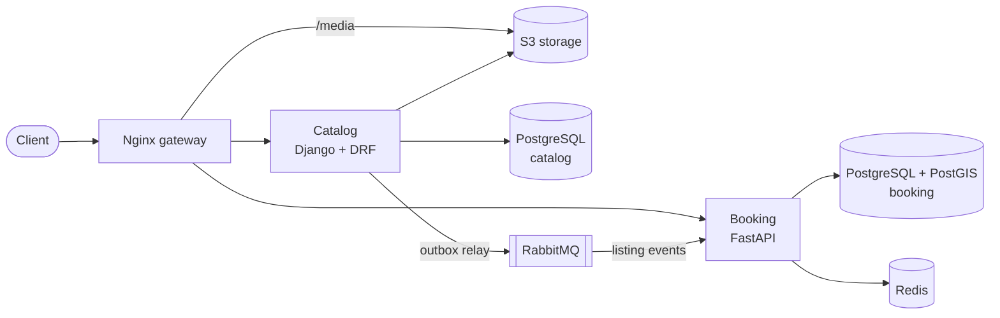
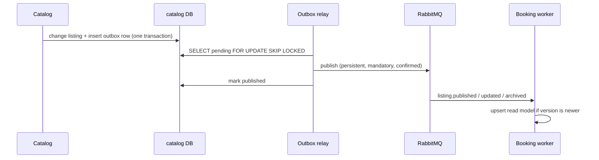
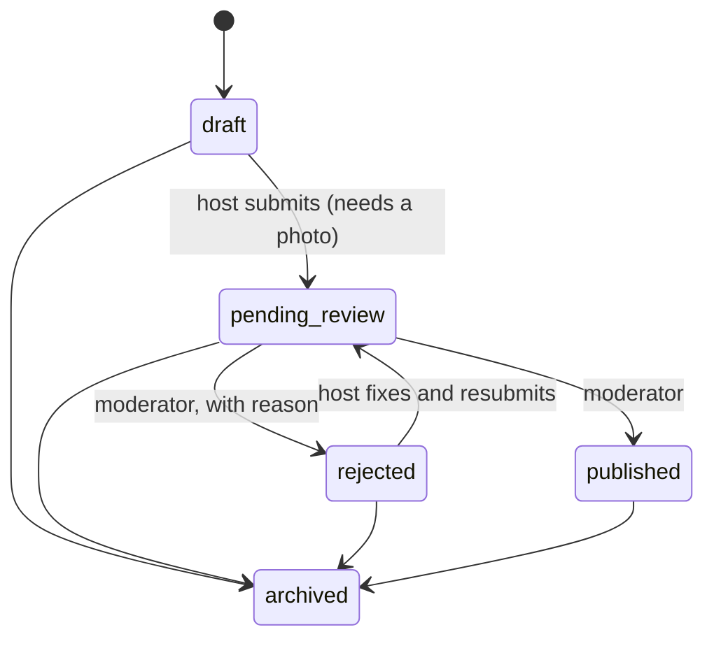

# Booking Platform

Backend for a short-term rental marketplace: hosts publish apartments and houses,
guests search by map and dates and book with prepayment. The core engineering goal is
that the same dates can never be sold twice, even under heavy concurrent load.

> Work in progress. Stages 1 and 2 are done; see the [roadmap](#roadmap).

## Architecture



| Service | Owns | Why this framework |
|---|---|---|
| **Catalog** | users and JWT issuing, listings, photos, moderation, reviews, notifications | Django Admin, auth, ORM and migrations out of the box: ideal for CRUD and a back-office |
| **Booking** | availability, pricing, quotes; bookings and payments (stage 3), search (stage 4) | async I/O and strict typing for the high-traffic path |

Each service owns its database and services never call each other synchronously while
serving a request. Booking verifies Catalog's JWTs locally with the public keys from JWKS
and keeps its own copy of listing data, fed by events. Design decisions are recorded in
[`docs/adr`](docs/adr).

### Event flow



Delivery is at least once and the consumer is idempotent by `version`; see
[ADR 4](docs/adr/0004-transactional-outbox.md). Event schemas are shared through
[`libs/contracts`](libs/contracts).

## Tech stack

Python 3.13 · Django 5.2 · DRF · FastAPI · SQLAlchemy 2 (async) · Alembic · FastStream ·
PostgreSQL 17 + PostGIS · Redis · RabbitMQ · Celery · S3-compatible storage (RustFS
locally) · Nginx · Docker Compose · uv · ruff · mypy · pytest + Testcontainers · GitHub Actions

## Quick start

Requirements: Docker with Compose v2 and Python 3 (only to generate secrets).

```bash
python scripts/init_env.py      # creates .env with random secrets
docker compose up -d --build
docker compose exec catalog-api python manage.py createsuperuser
```

| URL | What |
|---|---|
| http://localhost/api/docs/catalog/ | Catalog API (Swagger UI) |
| http://localhost/api/docs/booking/ | Booking API (Swagger UI) |
| http://localhost/admin/ | Moderation desk (Django Admin) |
| http://localhost/.well-known/jwks.json | Public keys for JWT verification |
| http://localhost:15672 | RabbitMQ management |
| http://localhost:9001 | Object storage console |

## API

All services sit behind one gateway, so clients see a single API. Paths are routed to the
owning service by Nginx.

### Catalog

| Method | Path | Who | Description |
|---|---|---|---|
| POST | `/api/v1/auth/register` | anyone | Create an account |
| POST | `/api/v1/auth/token` | anyone | Log in, get access and refresh tokens |
| POST | `/api/v1/auth/token/refresh` | anyone | Rotate the refresh token |
| POST | `/api/v1/auth/logout` | anyone | Revoke a refresh token |
| GET, PATCH | `/api/v1/users/me` | user | Profile |
| POST | `/api/v1/users/me/host` | user | Become a host (returns tokens with the new role) |
| GET | `/api/v1/amenities` | anyone | Amenity dictionary |
| GET | `/api/v1/listings/{id}` | anyone | Published listing |
| GET, POST | `/api/v1/host/listings` | host | Own listings |
| GET, PATCH, DELETE | `/api/v1/host/listings/{id}` | host | Manage a listing |
| POST | `/api/v1/host/listings/{id}/submit` | host | Send for moderation |
| POST | `/api/v1/host/listings/{id}/archive` | host | Withdraw a listing |
| POST | `/api/v1/host/listings/{id}/photos` | host | Get a presigned upload |
| POST | `/api/v1/host/listings/{id}/photos/{photo_id}/complete` | host | Confirm the upload |
| DELETE | `/api/v1/host/listings/{id}/photos/{photo_id}` | host | Remove a photo |

### Booking

Amounts are integers in minor units (cents). Periods are `[start_date, end_date)`.

| Method | Path | Who | Description |
|---|---|---|---|
| GET | `/api/v1/listings/{id}/calendar` | anyone | Nightly availability and prices |
| GET | `/api/v1/listings/{id}/quote` | anyone | Price breakdown for `check_in`, `check_out`, `guests` |
| GET, PUT | `/api/v1/host/listings/{id}/pricing` | host | Nightly, weekend price, cleaning fee, stay limits, discounts |
| GET, POST | `/api/v1/host/listings/{id}/seasonal-rates` | host | Prices for a period (no overlaps) |
| DELETE | `/api/v1/host/listings/{id}/seasonal-rates/{rate_id}` | host | Remove a seasonal rate |
| GET, POST | `/api/v1/host/listings/{id}/blocks` | host | Close dates for guests (no overlaps) |
| DELETE | `/api/v1/host/listings/{id}/blocks/{block_id}` | host | Reopen dates |

A listing is bookable once it is published and priced. Overlaps are rejected by
PostgreSQL exclusion constraints, so they hold under concurrent requests too
([ADR 5](docs/adr/0005-availability-and-pricing-model.md)).

Errors of both services follow [RFC 9457](https://www.rfc-editor.org/rfc/rfc9457)
(`application/problem+json`).

### Listing lifecycle



### Photo upload

1. `POST .../photos` returns a presigned POST pinned to the key, content type and 10 MB.
2. The client uploads the file straight to object storage; API workers never see the bytes.
3. `POST .../complete` queues a Celery task that validates the image, renders WebP
   variants without EXIF (no GPS leaks) and deletes the private original.

## Development

Each service is its own uv project; `libs/contracts` is installed into both as an
editable path dependency.

```bash
cd services/catalog    # or services/booking
uv sync
uv run pytest          # starts PostgreSQL (and RabbitMQ) via Testcontainers; Docker required
uv run mypy .
```

From the repository root: `make lint`, `make test`, `make typecheck`.

Install the git hooks once with `uvx pre-commit install`.

## Roadmap

- [x] **Stage 1. Foundation and Catalog:** monorepo, Docker Compose, CI, users, JWT
  (RS256 + JWKS), listings, moderation, direct photo uploads.
- [x] **Stage 2. Service integration:** transactional outbox → RabbitMQ → Booking read
  model (FastAPI, FastStream, SQLAlchemy async, Alembic); JWT verification via JWKS;
  calendar, pricing and quotes.
- [ ] **Stage 3. Bookings:** exclusion constraint against double booking, idempotency,
  booking state machine, payment provider mock with webhooks, refunds, emails.
- [ ] **Stage 4. Search and reviews:** geo search with filters, caching, keyset
  pagination, rate limiting, reviews feeding the rating.
- [ ] **Stage 5. Load and operations:** Locust results, metrics and dashboards,
  image publishing.
