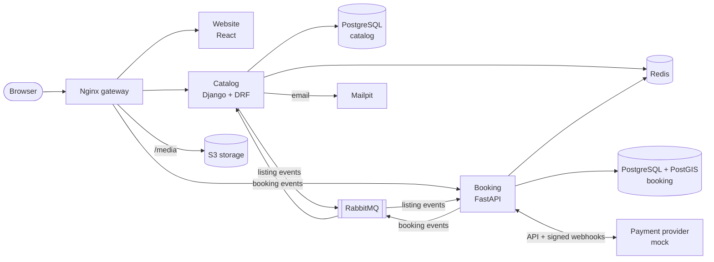

# Booking Platform

A short-term rental marketplace in the spirit of Booking.com and Airbnb, built as a
backend portfolio project. Hosts publish places, set prices and answer booking requests;
guests search on a map, book dates and pay. The core rule: **one night can never be sold
twice**, even when many guests book the same dates at the same moment.

Two Python services (Django and FastAPI) with their own databases, connected by events
through RabbitMQ. A small React site shows the whole flow. Everything starts with one
`docker compose up`.

## Highlights

- **No double bookings.** A PostgreSQL exclusion constraint on `daterange` rejects
  overlapping bookings inside the database, not in application code. A test fires
  8 parallel bookings for the same dates and expects exactly one to succeed.
- **Events without lost messages.** Transactional outbox: the change and its event are
  saved in one transaction, then relayed to RabbitMQ. Consumers are idempotent, and
  Booking's copy of the listings ignores events older than what it has.
- **Payments like a real provider.** A Stripe-like mock with a checkout page,
  HMAC-signed webhooks that are processed once, and refunds by cancellation policy.
- **Booking lifecycle.** Unpaid bookings hold dates for 15 minutes. Places can require
  the host's approval: 24 hours to answer, then 24 hours to pay. Background jobs expire
  holds and are safe to run in several replicas (`FOR UPDATE SKIP LOCKED`).
- **Service-to-service auth without calls.** Catalog signs JWTs with RS256; Booking
  checks them with Catalog's public key from JWKS.
- **Search.** Map area or radius, dates, guests, price, rating and amenities in one
  PostGIS query; Redis cache and per-user and per-client rate limits.
- **Photo uploads.** Presigned POST straight to S3 storage; a Celery task makes WebP
  versions and strips EXIF (no GPS leaks).
- **Host statistics in SQL.** Revenue and occupancy by month with `date_trunc`,
  `generate_series` and `GROUP BY`.
- **Operations.** Prometheus metrics, a Grafana dashboard, a Locust load
  test: 96 requests/s with p95 of 12 ms on one desktop, zero errors
  ([results](docs/load-testing.md)).
- **Quality.** About 240 tests against real PostgreSQL + PostGIS and Redis
  (Testcontainers), 94-95% coverage of both services, mypy (strict in Booking), ruff;
  CI tests everything and publishes Docker images.

## Architecture



| Service | Owns | Why this framework |
|---|---|---|
| **Catalog** (Django + DRF) | users and JWT, listings, photos, moderation, reviews, support, emails | Admin, auth and ORM out of the box: CRUD and a back office |
| **Booking** (FastAPI) | search, prices, calendar, bookings, payments, host statistics | async I/O and strict typing on the busy path |

The services never call each other over HTTP. Design decisions are explained in
[docs/architecture.md](docs/architecture.md), the API in [docs/api.md](docs/api.md).

## Tech stack

**Backend:** Python 3.13, Django 5.2, DRF, FastAPI, SQLAlchemy 2 (async), Alembic,
Celery, FastStream, PostgreSQL 17 + PostGIS, Redis, RabbitMQ, S3 (RustFS locally)

**Infrastructure:** Docker Compose, Nginx, Prometheus, Grafana, Locust, GitHub Actions

**Quality:** pytest + Testcontainers, mypy, ruff, uv, pre-commit

**Frontend:** React 19, TypeScript, Vite, TanStack Query, React Router, Leaflet

## Run it

Requirements: Docker with Compose v2 and Python 3 (only to generate secrets).

```bash
python scripts/init_env.py                 # .env with random secrets
docker compose up -d --build
python loadtest/seed.py --count 300        # demo: 300 places with photos, a year of stays
docker compose exec catalog-api python manage.py createsuperuser
```

| URL | What |
|---|---|
| http://localhost/ | The website |
| http://localhost/admin/ | Django Admin: moderation and support |
| http://localhost/api/docs/catalog/, http://localhost/api/docs/booking/ | Swagger UI |
| http://localhost:8025 | Mailpit: every email the platform sends |
| http://localhost:3000 | Grafana (admin / `GRAFANA_ADMIN_PASSWORD` from `.env`) |

### Things to try

1. Register, search on the map, pick dates in the calendar and book.
2. Pay with the test card `4242 4242 4242 4242` (`4000 0000 0000 0002` is declined).
   The booking is confirmed by the webhook; the email is in Mailpit.
3. In the profile, become a host. Add a place with photos, then publish it in Django
   Admin (Listings). Set prices, close dates, turn off instant booking.
4. Book it from another account: the host gets a request to accept or decline.
5. Open Hosting → Statistics. As the demo host (`seed-host@example.com`, set a password
   in Django Admin) it shows a full year.

## Project structure

```
backend/
  catalog/        Django + DRF service
  booking/        FastAPI service
  payment-mock/   fake payment provider
  contracts/      event schemas shared by both services
frontend/         React + TypeScript site
infra/            Nginx, PostgreSQL init, Prometheus, Grafana
loadtest/         Locust scenario and demo data
docs/             architecture, API, load test results
```

## Development

```bash
cd backend/booking            # or backend/catalog, backend/payment-mock
uv sync
uv run python -m pytest       # needs Docker: tests start their own databases
uv run python -m mypy .
```

From the repository root: `make lint`, `make test`, `make typecheck`. The site in dev
mode: `cd frontend && npm install && npm run dev` (uses the running stack).
