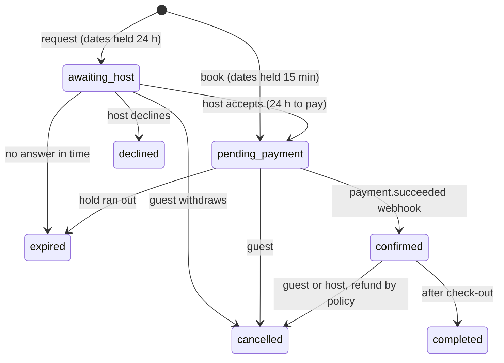
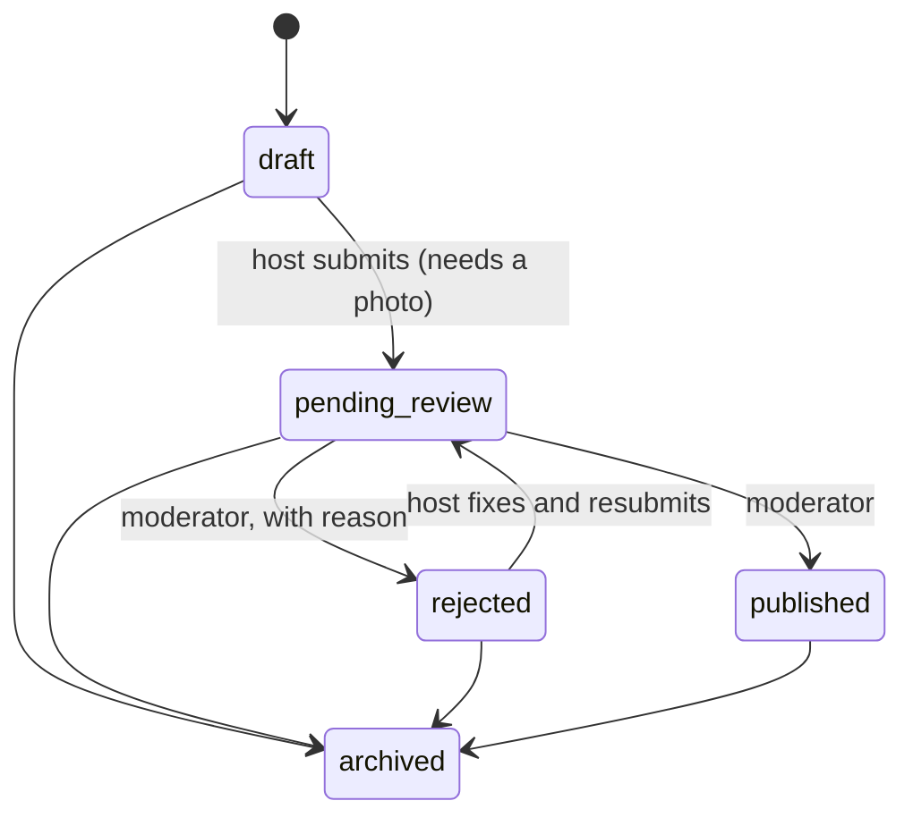

# API

The live reference is Swagger UI: http://localhost/api/docs/catalog/ and
http://localhost/api/docs/booking/. This page is the overview.

All services sit behind one gateway, so clients see a single API. Paths are routed to the
owning service by Nginx.

## Catalog

| Method | Path | Who | Description |
|---|---|---|---|
| POST | `/api/v1/auth/register` | anyone | Create an account |
| POST | `/api/v1/auth/token` | anyone | Log in, get access and refresh tokens |
| POST | `/api/v1/auth/token/refresh` | anyone | Rotate the refresh token |
| POST | `/api/v1/auth/logout` | anyone | Revoke a refresh token |
| GET, PATCH | `/api/v1/users/me` | user | Profile |
| POST | `/api/v1/users/me/host` | user | Become a host (returns tokens with the new role) |
| POST | `/api/v1/users/me/password` | user | Change the password (needs the current one) |
| GET | `/api/v1/favorites` | user | Saved listings |
| PUT, DELETE | `/api/v1/favorites/{listing_id}` | user | Save or unsave a listing |
| GET | `/api/v1/amenities` | anyone | Amenity dictionary |
| GET | `/api/v1/listings/{id}` | anyone | Published listing with its rating (cached) |
| GET | `/api/v1/listings/{id}/reviews` | anyone | Reviews, newest first (`page`, `page_size`) |
| GET | `/api/v1/reviews/pending` | user | Own finished stays that can still be reviewed |
| POST | `/api/v1/reviews` | user | Review a finished stay: 1 to 5 and a text, once, within 14 days |
| POST | `/api/v1/host/reviews/{id}/reply` | host | Reply publicly to a review, once |
| GET, POST | `/api/v1/support/tickets` | user | Own support requests; open a new one |
| GET | `/api/v1/support/tickets/{id}` | user | A request with its messages |
| POST | `/api/v1/support/tickets/{id}/messages` | user | Write to support again |
| POST | `/api/v1/support/tickets/{id}/close` | user | Close a solved request |
| GET, POST | `/api/v1/host/listings` | host | Own listings |
| GET, PATCH, DELETE | `/api/v1/host/listings/{id}` | host | Manage a listing |
| POST | `/api/v1/host/listings/{id}/submit` | host | Send for moderation |
| POST | `/api/v1/host/listings/{id}/archive` | host | Withdraw a listing |
| POST | `/api/v1/host/listings/{id}/photos` | host | Get a presigned upload |
| POST | `/api/v1/host/listings/{id}/photos/{photo_id}/complete` | host | Confirm the upload |
| DELETE | `/api/v1/host/listings/{id}/photos/{photo_id}` | host | Remove a photo |

## Booking

Amounts are integers in minor units (cents). Periods are `[start_date, end_date)`.

| Method | Path | Who | Description |
|---|---|---|---|
| GET | `/api/v1/listings` | anyone | Search: map area or point, dates, filters, sorting |
| GET | `/api/v1/listings/{id}/calendar` | anyone | Nightly availability and prices |
| GET | `/api/v1/listings/{id}/quote` | anyone | Price breakdown for `check_in`, `check_out`, `guests` |
| GET, PUT | `/api/v1/host/listings/{id}/pricing` | host | Nightly, weekend price, cleaning fee, stay limits, discounts, `instant_book` |
| GET, POST | `/api/v1/host/listings/{id}/seasonal-rates` | host | Prices for a period (no overlaps) |
| DELETE | `/api/v1/host/listings/{id}/seasonal-rates/{rate_id}` | host | Remove a seasonal rate |
| GET, POST | `/api/v1/host/listings/{id}/blocks` | host | Close dates for guests (no overlaps) |
| DELETE | `/api/v1/host/listings/{id}/blocks/{block_id}` | host | Reopen dates |

Search example: free places for two in a map area, with the price of the stay:

```
GET /api/v1/listings?bbox=-9.25,38.68,-9.08,38.80&check_in=2027-05-03&check_out=2027-05-07&guests=2&amenities=wifi
```

Other filters: `lat`, `lon`, `radius_km`, `country`, `city`, `property_type`,
`min_bedrooms`, `min_rating`, `currency` with `min_price` / `max_price`; `sort` is
`distance`, `price` or `rating`. Lists take `limit` and `offset` and return
`{"items": [...], "total": 42, "limit": 20, "offset": 0}`.

A listing is bookable once it is published and priced.

### Bookings and payments

| Method | Path | Who | Description |
|---|---|---|---|
| POST | `/api/v1/bookings` | user | Book: prices the stay and holds the dates for 15 minutes (a request: 24 hours for the host's answer) |
| GET | `/api/v1/bookings`, `/api/v1/bookings/{id}` | guest | Own bookings, newest first |
| POST | `/api/v1/bookings/{id}/payments` | guest | Start a payment, get the checkout URL |
| POST | `/api/v1/bookings/{id}/cancel` | guest | Cancel; refund by policy |
| GET, POST | `/api/v1/bookings/{id}/messages` | guest | Messages with the host |
| GET | `/api/v1/host/bookings`, `/api/v1/host/bookings/{id}` | host | Stays at own listings, by check-in date; `status`, `upcoming` filters |
| POST | `/api/v1/host/bookings/{id}/accept` | host | Accept a request; the guest has 24 hours to pay |
| POST | `/api/v1/host/bookings/{id}/decline` | host | Decline a request; the dates are free again |
| POST | `/api/v1/host/bookings/{id}/cancel` | host | Cancel; the guest gets a full refund |
| GET | `/api/v1/host/stats?year=2026` | host | Revenue, bookings, occupancy by month, best places |
| GET, POST | `/api/v1/host/bookings/{id}/messages` | host | Messages with the guest |



Two active bookings can never overlap: a PostgreSQL exclusion constraint guarantees it,
even for requests that arrive at the same moment. Payment results arrive as HMAC-signed
webhooks, each processed once; refunds are sent to the provider when a booking is
cancelled.

Cancellation policy: host cancels → full refund; guest cancels 7+ days before check-in →
full refund, 1 to 6 days → half, on the day → none.

Errors of all services follow [RFC 9457](https://www.rfc-editor.org/rfc/rfc9457)
(`application/problem+json`).

## Caching and rate limits

- Search pages are cached in Redis for 30 seconds (`X-Cache: HIT|MISS`); the listing page
  is cached until the listing changes. Calendar, quotes and bookings are never cached.
- Booking allows 60 searches and 120 calendar/quote requests per minute per client
  address, and 20 booking actions per minute per user (a counter in Redis). Extra
  requests get 429 with `Retry-After`. Catalog limits login and registration attempts.

## Listing lifecycle



## Photo upload

1. `POST .../photos` returns a presigned POST pinned to the key, content type and 10 MB.
2. The client uploads the file straight to object storage; API workers never see the bytes.
   Browsers post to `http://localhost/storage/...`: the gateway passes only POSTs on to
   the storage, so the site and the upload share one origin and need no CORS setup.
3. `POST .../complete` queues a Celery task that validates the image, renders WebP
   variants without EXIF (no GPS leaks) and deletes the private original.
